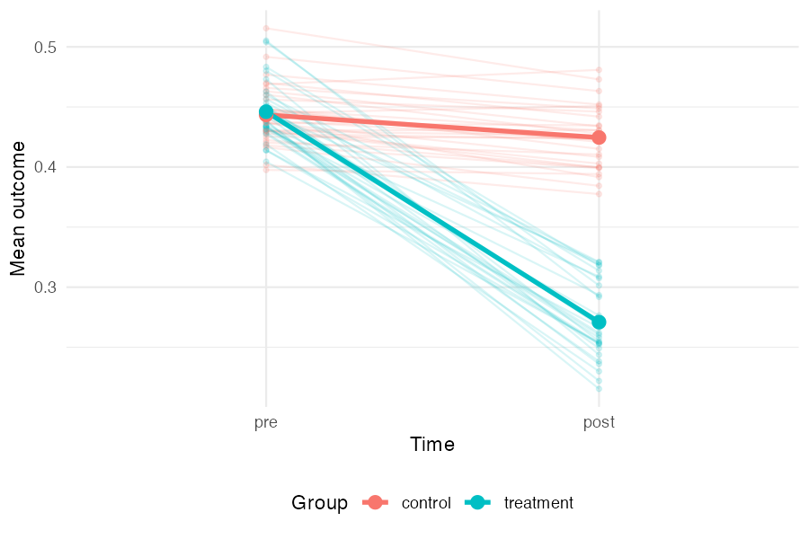
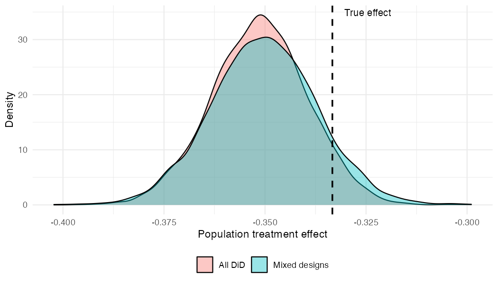
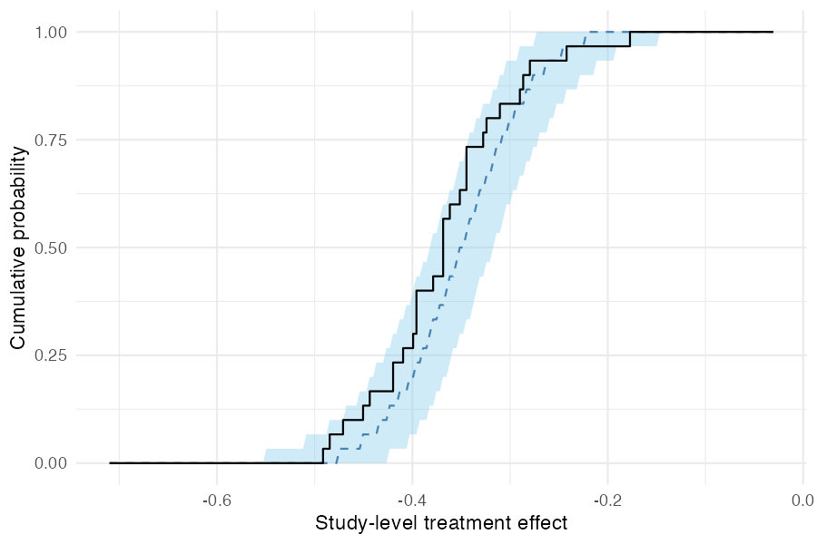
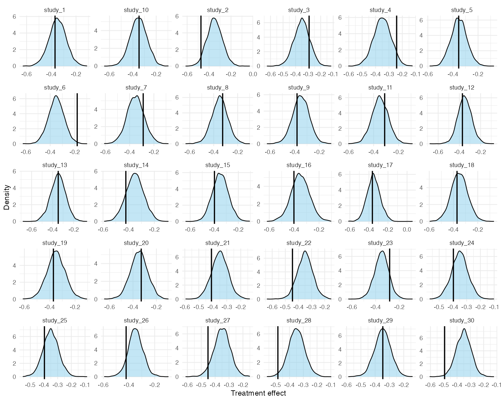

```{r setup, include = FALSE}
knitr::opts_chunk$set(
  collapse = TRUE,
  comment = "#>",
  fig.path = "figures/mixed-designs-"
)
```

In practice, a literature review often turns up studies with very different designs. Some may be full difference-in-differences studies reporting pre/post outcomes for both treatment and control groups; others may be RCTs reporting only post-treatment outcomes; others may be single-arm pre-post studies with no control group at all.

metadid's core assumption is that all of these designs are partial views of the same underlying DiD process. This vignette demonstrates that, even when studies provide very different amounts of information, the model can recover the true population treatment effect.

## Simulation setup

We simulate 30 studies from a known hierarchical DiD model:

```{r simulate, eval = FALSE}
library(metadid)
library(dplyr)
library(ggplot2)

sim <- simulate_meta_did(
  n_studies     = 30,
  n_control     = 80,
  n_treatment   = 80,
  true_effect   = -0.15,
  sigma_effect  = 0.03,
  true_trend    = -0.02,
  sigma_trend   = 0.01,
  baseline_mean = 0.45,
  baseline_sd   = 0.02,
  rho           = 0.5,
  seed          = 4718
)
```

The true population treatment effect is -0.15 on the raw scale. With baseline normalisation (the default), this corresponds to approximately -0.333 on the normalised scale.

## Visualising the latent DiD structure

Before fitting any models, it is useful to see the data-generating process directly. The plot below shows each study as a pair of faint lines (control and treatment group means from pre to post), with the grand mean overlaid in bold. The treatment group starts at roughly the same level as the control group but drops much further — the gap between the two bold slopes is the treatment effect. The spread of the faint lines reflects between-study heterogeneity.

```{r spaghetti, eval = FALSE, fig.width = 6, fig.height = 4}
study_means <- sim |>
  group_by(study_id, group, time) |>
  summarise(mean_value = mean(value), .groups = "drop") |>
  mutate(time = factor(time, levels = c("pre", "post")))

grand_means <- study_means |>
  group_by(group, time) |>
  summarise(mean_value = mean(mean_value), .groups = "drop")

ggplot(study_means, aes(x = time, y = mean_value, colour = group,
                        group = interaction(study_id, group))) +
  geom_line(alpha = 0.15) +
  geom_point(alpha = 0.15, size = 1) +
  geom_line(data = grand_means, aes(group = group), linewidth = 1.2) +
  geom_point(data = grand_means, aes(group = group), size = 3) +
  labs(x = "Time", y = "Mean outcome", colour = "Group") +
  theme_minimal() +
  theme(legend.position = "bottom")
```



## Two scenarios

We compare two ways of using the same underlying data.

### Scenario A: all studies treated as DiD

In the best case, every study provides full four-cell summary statistics (pre/post × control/treatment). This gives the model maximum information per study.

```{r all-did, eval = FALSE}
all_did <- as_summary_did(sim)

fit_all_did <- meta_did(
  summary_data  = all_did,
  seed          = 4718
)

print(fit_all_did)
```

```
#> Bayesian meta-analysis (metadid)
#> Studies: DiD = 30 | RCT = 0 | Pre-Post = 0 | DiD (change only) = 0 
#> Population treatment effect: -0.350  90% CI [-0.370, -0.329]
```

### Scenario B: mixed designs

Now suppose that, from the same underlying data, only a third of studies provide full DiD information. Another third are RCTs (post-treatment outcomes only), and the remaining third are pre-post studies (treatment arm only, no control group).

```{r mixed, eval = FALSE}
study_ids <- unique(sim$study_id)
did_ids <- study_ids[1:10]
rct_ids <- study_ids[11:20]
pp_ids  <- study_ids[21:30]

# Preserve true_params for subsetting
true_params <- attr(sim, "true_params")

sim_did <- sim |> filter(study_id %in% did_ids)
sim_rct <- sim |> filter(study_id %in% rct_ids)
sim_pp  <- sim |> filter(study_id %in% pp_ids)

attr(sim_did, "true_params") <- true_params |> filter(study_id %in% did_ids)
attr(sim_rct, "true_params") <- true_params |> filter(study_id %in% rct_ids)
attr(sim_pp, "true_params")  <- true_params |> filter(study_id %in% pp_ids)

mixed <- bind_rows(
  as_summary_did(sim_did),
  as_summary_rct(sim_rct),
  as_summary_pp(sim_pp)
)

fit_mixed <- meta_did(
  summary_data = mixed,
  seed         = 4718
)

print(fit_mixed)
```

```
#> Bayesian meta-analysis (metadid)
#> Studies: DiD = 10 | RCT = 10 | Pre-Post = 10 | DiD (change only) = 0 
#> Population treatment effect: -0.341  90% CI [-0.365, -0.317]
```

## Comparing posteriors

Both fits recover the true normalised effect (-0.333, dashed line). The mixed-design posterior is slightly wider, reflecting the information lost by having two-thirds of the studies provide incomplete data — but the difference is modest.

```{r comparison, eval = FALSE}
draws_did <- as.numeric(
  fit_all_did$fit$draws("treatment_effect_mean", format = "draws_matrix")
)
draws_mix <- as.numeric(
  fit_mixed$fit$draws("treatment_effect_mean", format = "draws_matrix")
)

comp_df <- data.frame(
  value = c(draws_did, draws_mix),
  scenario = rep(c("All DiD", "Mixed designs"), each = length(draws_did))
)

ggplot(comp_df, aes(x = value, fill = scenario)) +
  geom_density(alpha = 0.4) +
  geom_vline(xintercept = -0.15 / 0.45, linetype = "dashed", linewidth = 0.8) +
  annotate("text", x = -0.15 / 0.45 + 0.003, y = Inf, label = "True effect",
           hjust = 0, vjust = 1.5, size = 3.5) +
  labs(x = "Population treatment effect", y = "Density", fill = NULL) +
  theme_minimal() +
  theme(legend.position = "bottom")
```



The key takeaway: by assuming a common latent DiD structure, the model borrows strength across designs. RCT and pre-post studies contribute meaningful information about the treatment effect, even though they each observe less of the underlying process than a full DiD study.

## Posterior predictive checks

### Study-level effects

As a calibration check, `pp_check_cdf(type = "summary")` compares the empirical CDF of observed study-level treatment effects (step function) to the posterior predictive CDF (ribbon and dashed median). If the model is well-specified, the observed ECDF should fall within the predictive band.

```{r pp-check-cdf, eval = FALSE}
pp_check_cdf(fit_mixed, type = "summary")
```



### Per-study densities

For a more granular view, `pp_check_effects()` shows each study's observed naive treatment effect (vertical line) against the posterior predictive density for that study. This is useful for identifying individual studies that the model struggles to explain.

```{r pp-check-effects, eval = FALSE}
pp_check_effects(fit_mixed)
```



## Checking the assumptions the data cannot

Posterior predictive checks ask whether the model explains the data it was given. They cannot ask whether the *pooling* is justified, because the assumptions that license it — that pre-post studies share a trend distribution with DiD studies, that all designs estimate one effect — are not identified by the data. Three diagnostics address them directly.

### Which studies is the result resting on?

The pooled effect is an inverse-variance weighted average, so a handful of large or precise studies can dominate it. `information_share()` reports each study's share and `plot_information_share()` draws it:

```{r info-share, eval = FALSE}
information_share(fit_mixed) |> head(5)
```

```
#>    study_id design         se     weight
#> 29 study_29     pp 0.02458929 0.04404526
#> 30 study_30     pp 0.02517211 0.04360394
#> 26 study_26     pp 0.02658745 0.04252759
#> 25 study_25     pp 0.02719201 0.04206673
#> 27 study_27     pp 0.02813506 0.04134767
```

The five largest shares all belong to **pre-post** studies, which is not the
obvious answer. Their change-score variance is
$\sigma^2_{pre} + \sigma^2_{post} - 2\rho\sigma_{pre}\sigma_{post}$ over $n$,
which at $\rho = 0.5$ is smaller than a DiD study's double difference across
two arms --- so the design observing *less* of the latent process can carry more
weight per study, because what it does observe it observes precisely.

```{r info-share-plot, eval = FALSE}
plot_information_share(fit_mixed)
```

A design contributing far more than its study count suggests the pooled number is really that design's answer.

Two caveats, and the second matters more than it looks. The weights ignore the information a post-only study spends on its baseline difference, so its share is slightly overstated. And these are weights on the **mean**: they say nothing about a study's effect on the between-study SD. A study can carry the smallest weight in the analysis and still double the width of the pooled interval, which is what the influence section below demonstrates.

### Do the designs agree?

`design_agreement()` refits with `design_effects = TRUE`, letting each non-DiD design take an offset relative to the DiD anchor, and returns those offsets. Zero means the designs are exchangeable; an interval excluding zero means they are not.

```{r design-agreement, eval = FALSE}
agree <- design_agreement(fit_mixed)
agree$offsets
```

```
#>     design    estimate          lo           hi n_studies
#> rct    rct -0.03173571 -0.07905057 0.0151316666        10
#> pp      pp -0.04539894 -0.09220292 0.0002122077        10
```

```{r design-agreement-plot, eval = FALSE}
plot_design_agreement(agree)
```

Both offsets straddle zero, so the designs are compatible --- but only just, and that is worth dwelling on. These data were simulated from a *single* latent process, so the true offsets are zero, and yet the pre-post offset comes out at −0.045 with an interval whose upper end is 0.0002. A reader who saw that in an applied analysis would reasonably wonder about the pre-post studies.

Which is the honest lesson of this diagnostic: with ten studies per design it has limited power, and a borderline offset is as likely to be noise as signal. Read it as a screen, not a test. A nonzero offset also would not say *why* --- a real difference in the estimand, or a fault in how that design is handled, look identical from here.

### How far would a trend difference have to go?

The sharpest assumption in a mixed analysis is that pre-post studies draw their time trends from the same population as DiD studies. Pre-post studies observe $\beta_i + \theta_i$ and cannot separate the two, so they inherit the trend distribution the DiD studies identify. If their trends really run systematically lower or higher by $\Delta$, the model credits the difference to treatment.

`sensitivity_trend()` refits across a grid of $\Delta$ and traces the result:

```{r sensitivity, eval = FALSE}
sweep <- sensitivity_trend(fit_mixed, delta = seq(-0.06, 0.06, by = 0.03))
sweep$grid
```

```
#>   delta   estimate         lo         hi divergences
#> 1 -0.06 -0.3281324 -0.3510750 -0.3055063           0
#> 2 -0.03 -0.3348237 -0.3568609 -0.3131225           0
#> 3  0.00 -0.3413227 -0.3649053 -0.3173717           1
#> 4  0.03 -0.3478054 -0.3738507 -0.3232074           7
#> 5  0.06 -0.3524112 -0.3834446 -0.3223728           8
```

Watch the `divergences` column as well as the estimate. It climbs as $\Delta$
moves the pre-post trends away from the DiD studies' --- the data are fighting
the assumption, and the geometry gets harder. A sweep that diverges heavily at
one end is itself telling you something.

```{r sensitivity-plot, eval = FALSE}
plot_sensitivity_trend(sweep)
```

The response is close to linear, with slope $-\omega_P$ where $\omega_P$ is the share of the information about the effect that comes from the pre-post studies. Two readings matter:

```{r delta-star, eval = FALSE}
sweep$omega_empirical   # what a unit shift in Delta costs the pooled effect
sweep$delta_ci          # the shift at which the interval first includes zero
delta_star(fit_mixed)$median   # the same breakdown value, computed analytically
```

```
#>   omega_empirical delta_ci delta_star
#> 1       0.2051303       NA -0.8262403
```

So the pre-post studies carry about a fifth of the information about the effect,
and `delta_ci` is `NA` because the interval never reaches zero anywhere on this
grid. $\Delta^*$ of −0.83 says the pre-post trends would have to run 83
percentage points of baseline below the DiD trends, over each study's own
pre-to-post interval, before the estimate could be explained away.

Read $\Delta^*$ against plausible secular trends: if explaining the estimate away would need pre-post trends running tens of percentage points of baseline below the DiD trends, over each study's own pre-to-post interval, the conclusion is robust to the assumption.

`delta_star()` gives the same number analytically from a single fit, without the refits, by computing $\omega_P$ from the per-study sampling variances and the variance components. `omega_pp()` also reports a `cap`: however many pre-post studies are added, their share cannot exceed what the DiD studies know about trends. Borrowing is self-limiting, and the anchoring design sets the ceiling.

A small $\Delta^*$ is the signal to worry about — and the remedy is usually not more pre-post studies, since the cap binds, but more DiD evidence on trends.

## Which studies would change the answer? {#which-studies-would-change-the-answer}

`information_share()` says where the weight sits. It does not say whether any study is pulling against the rest. For that, `study_influence()` does leave-one-study-out by importance sampling, with exact refits only for the studies it flags.

To see it work, plant one discordant study among twelve well-behaved ones — and deliberately make it **small**, with twenty per arm against the others' hundred:

```{r outlier-data, eval = FALSE}
sim12 <- simulate_meta_did(n_studies = 12, true_effect = -0.15,
                           sigma_effect = 0.03, true_trend = -0.04,
                           sigma_trend = 0.02, seed = 21)
base <- as_summary_did(sim12)
base$rho <- 0.5

odd <- base[1, ]
odd$study_id <- "odd_one"
odd$n_control <- 20L
odd$n_treatment <- 20L
odd$mean_post_treatment <- odd$mean_pre_treatment * 1.25   # wrong sign, large

fit_odd <- meta_did(summary_data = bind_rows(base, odd), seed = 5)
```

```{r outlier-influence, eval = FALSE}
inf <- study_influence(fit_odd, refit = "flagged")
```

```
#>    study_id design     weight    elpd_i    khat flagged d_effect_mean
#> 13  odd_one    did 0.06900657 -4.096179 1.31939    TRUE     0.0507775
#>    d_effect_sd d_ci_width
#> 13   0.1188744  0.1065678
#>
#>  (the twelve others: weight 0.0773 to 0.0778, khat 0.01 to 0.41)
```

Read the columns against each other, because they disagree:

- **`weight` is the lowest in the analysis** (0.069 against 0.077). A weight table would not have found this study. The reason is circular and worth understanding: the outlier inflates $\tau_\theta$, and once $\tau^2$ dominates every $s_i^2$ the weights $1/(s_i^2 + \tau^2)$ go nearly uniform. A discordant study destroys the precision advantage that would have made it look important.
- **`elpd_i` separates it cleanly** at −4.10 against +2.4 to +4.4. This is how badly the rest of the evidence predicts it, and it is the most informative column here.
- **`khat` of 1.32 flags it**, and nothing else is flagged.
- **The refit says where the damage lands.** Removing it moves the pooled mean by 0.051 — but moves $\tau_\theta$ by 0.119 and the interval width by 0.107. Reporting only the mean would have understated this study by half.

`refit = "flagged"` fits once per flagged study and nothing otherwise; the default `refit = "none"` does no fitting at all. With individual-level data a refit is expensive, so nothing runs unless you ask.

```{r outlier-plot, eval = FALSE}
plot_study_influence(inf)
```

A study in the top-left — high $k$, low weight — is exactly the case above: it is not pulling the mean, it is inflating the spread.

### Two limitations worth knowing

**Leave-one-out cannot see masking.** Add a *second* discordant study and neither is flagged: each is explained by the other's inflation of $\tau$, and the weights go uniform (measured: no study flagged, the two largest $k$ at 0.68 and 0.54, and the
largest weight only 1.09 times the smallest). If you suspect more than one problem study, drop them jointly rather than trusting one-at-a-time.

**Sample size buys almost nothing here.** Repeating the exercise with the outlier at n = 2000 instead of 20 gives it a weight of 0.0787 against 0.077 for the clean studies — a 2% premium for a hundredfold sample — because it inflates $\tau$ just the same. Its cost is nearly identical too (+0.056 on the mean, +0.139 on $\tau$). In a random-effects model a discordant study cannot dominate by being large; it widens everything instead.

## How much of this is the priors?

Several quantities in this model are weakly identified: between-study SDs with few studies, $\kappa$ when no randomised study carries pre-treatment data, $\rho$ when nobody reports it. For those the posterior can be largely the prior wearing a posterior's clothes, and a summary table will not say so.

### Power-scaling, without refitting

Fits carry `lprior` (the log density of the priors you chose) and `log_lik` (per-study log-likelihood), which is what [priorsense](https://github.com/n-kall/priorsense) needs. It perturbs the prior by importance-reweighting the draws you already have, so the whole sweep costs no refits:

```{r priorsense, eval = FALSE}
library(priorsense)
# Restrict the variables, or every study-level raw parameter is listed too.
powerscale_sensitivity(
  fit_mixed$fit,
  variable = c("treatment_effect_mean", "treatment_effect_sd",
               "time_trend_mean", "time_trend_sd", "baseline_difference_sd")
)
```

```
#> Sensitivity based on cjs_dist
#> Prior selection: all priors
#> Likelihood selection: all data
#>
#>                variable prior likelihood diagnosis
#>   treatment_effect_mean 0.001      0.022         -
#>     treatment_effect_sd 0.001      0.207         -
#>         time_trend_mean 0.000      0.044         -
#>           time_trend_sd 0.001      0.051         -
#>  baseline_difference_sd 0.015      0.244         -
```

Read the two columns together:

- **Low prior, high likelihood** — the data are doing the work. What you want, and what every row here shows: prior sensitivity is 0.015 at worst.
- **High prior, low likelihood** — the posterior is tracking your prior rather than the evidence. Nothing is in that state here, but `baseline_difference_sd` has the largest prior sensitivity of the five, which fits: with ten DiD studies there is not much information about the spread of baseline imbalance.
- **Both high** — prior-data conflict: the prior is informative *and* disagrees.

Parameters that are constant across draws (`kappa` when it is fixed, for
instance) come back as `NaN` rather than zero, since there is no posterior to
perturb.

The parameters to watch in this model are `treatment_effect_sd` and `time_trend_sd` when there are few studies, and `kappa` whenever `kappa = "estimate"` was used without a randomised DiD study to anchor it — the package warns in that case, and this is how to see the consequence.

### Widening every prior by a common factor

Power-scaling *is* that analysis, done efficiently. Raising a prior to the power $\alpha$ scales a normal prior's SD by $1/\sqrt{\alpha}$, so halving all the precisions — widening every scale by a factor of 2 — is $\alpha = 0.25$:

```{r powerscale-grid, eval = FALSE}
powerscale_plot_dens(fit_mixed$fit, component = "prior",
                     alpha = c(0.25, 0.5, 1, 2, 4))
```

If you would rather do it explicitly, by refitting against genuinely wider priors, `set_priors()` takes the scales directly:

```{r widen-priors, eval = FALSE}
wide <- set_priors(
  treatment_effect_mean  = normal(0, 20),     # default normal(0, 10)
  treatment_effect_sd    = cauchy(10),        # default cauchy(5)
  time_trend_mean        = normal(0, 20),
  time_trend_sd          = cauchy(10),
  baseline_difference_sd = cauchy(0.2),       # default cauchy(0.1)
  sigma                  = cauchy(10)
)

fit_wide <- meta_did(summary_data = mixed, priors = wide, seed = 4718)

rbind(
  default = summary(fit_mixed)[1, c("mean", "lo", "hi")],
  wide    = summary(fit_wide)[1, c("mean", "lo", "hi")]
)
```

```
#>               mean         lo         hi
#> default -0.3413227 -0.3649053 -0.3173717
#> wide    -0.3414702 -0.3647145 -0.3187871
```

With thirty studies the pooled effect is identified by the data and this comparison should barely move. The same exercise on a five-study analysis can move it considerably, which is worth knowing before publishing one.

Two things to keep in mind. The sensitivity reported is to the *hyperpriors* — the population means and SDs you set — and not to the standard-normal terms that implement the hierarchy itself, which are structure rather than a choice. And `log_lik` is emitted only for summary-level fits: an individual-level study's contribution is not yet computed, so rather than hand `loo()` a silently incomplete likelihood the vector comes back empty. Prior sensitivity works either way.

### Leave-one-study-out, and why `log_lik` is the wrong input

`log_lik` makes PSIS cross-validation available in principle, with the study as the unit left out. But do **not** read Pareto $k$ from it:

```{r loo-wrong, eval = FALSE}
# Don't: k will be high for nearly every study, whatever its influence.
loo::loo(fit_mixed$fit$draws("log_lik"))
```

`log_lik[i]` is conditional on study $i$'s own $\theta_i$, $\beta_i$ and $\gamma_i$, and those are informed almost entirely by study $i$. Leaving it out therefore removes all the information about its own parameters, the importance ratios become hopelessly heavy-tailed, and $k$ is large for every study regardless of whether any is unusual. On a well-behaved twenty-study fit this gives 18 of 20 studies above 0.7 — a diagnosis of the method, not the data.

Use [`study_influence()`](#which-studies-would-change-the-answer) instead, which runs PSIS on `log_lik_marginal`, where the study-level parameters are integrated out.
